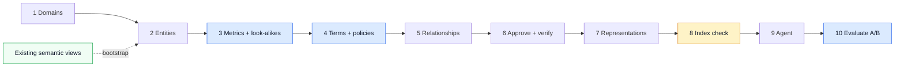
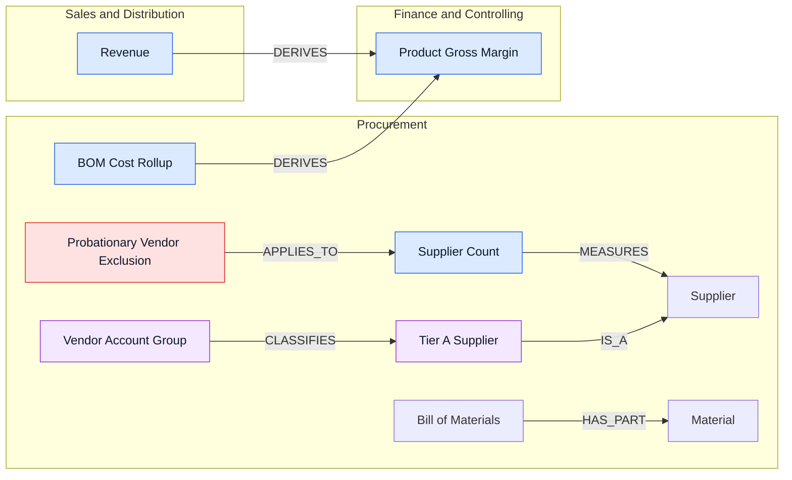
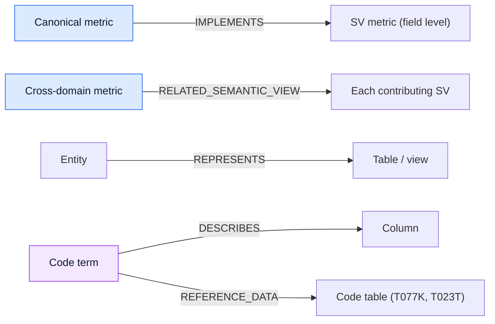
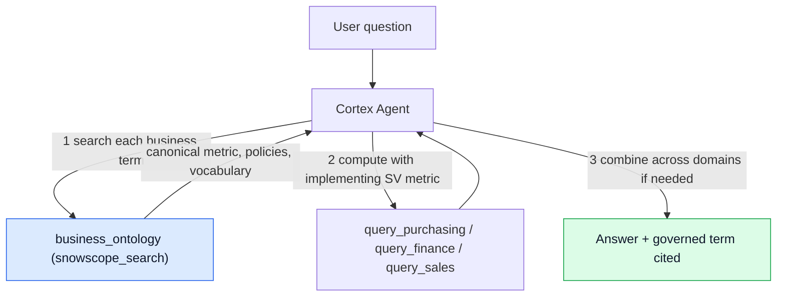
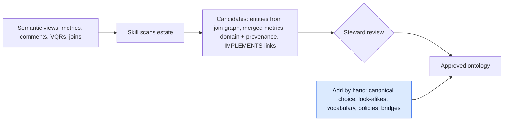

# Getting Started with Business Ontology

> **Private Preview.** Business Ontology must be enabled on your Snowflake account. In Snowsight, check **Catalog > Business Ontology (Preview)**. Contact your Snowflake account team to enable it. Behaviour, APIs and node kinds may change before general availability.

This guide walks through the build used in the SAP supply-chain demo (V2): three domain semantic views plus a Business Ontology (BON) that tells the agent what the business means. Every step has a `$business-ontology` CoCo prompt and the SQL the skill runs underneath.

---

## What is Business Ontology?

Business Ontology is the governed meaning layer in Horizon Catalog. It models shared business meaning as a connected graph of **terms, metrics and entities**, organised into **domains**, linked by **typed relationships**, and tied to the Snowflake objects that implement them through **representations**. Only approved items are visible to agents.

**Semantic Views tell Snowflake *how* to compute a metric. Business Ontology tells everyone *what* that metric means, *which* one is canonical, *who* approved it, and *whether* teams agree.**

| Layer | Owns | Example from the demo |
|---|---|---|
| Semantic View | Tables, joins, dimensions, metric SQL; executes the number | `PURCHASING_ENRICHED_SV` has both `VENDOR_RECORD_COUNT` (15) and `ACTIVE_SUPPLIER_COUNT` (14) |
| Business Ontology | Which metric is canonical, business vocabulary, policies, cross-domain links | "Supplier Count" means active suppliers; *Probationary Vendor Exclusion* applies to it; it is implemented by `ACTIVE_SUPPLIER_COUNT` |

<!-- VISUAL 1: SV-alone vs SV+BON comparison cards (getting-started-business-ontology.html, #what — .compare-grid) -->

```
Semantic views alone                     Semantic views + Business Ontology
────────────────────                     ──────────────────────────────────
"How many suppliers do we have?"          "How many suppliers do we have?"
Two defensible metrics exist.             BON: Supplier Count = active suppliers,
Agent picks one — or hedges.              policy excludes probationary vendors,
→ 15 (vendor records) or "15 or 14"       implemented by ACTIVE_SUPPLIER_COUNT.
                                          → 14, with the governed term cited
```

The SV still computes the number. BON makes the agent pick the right one and say why.

---

## Prerequisites

| Requirement | Details |
|---|---|
| Account | Business Ontology enabled (Private Preview); search indexing enabled in your region |
| Snowsight | **Catalog > Business Ontology (Preview)** |
| Role | A role with ontology privileges. Domains use READ / SUGGEST / MODIFY / OWNERSHIP. The demo used ACCOUNTADMIN. |
| Data | Tables loaded, and ideally semantic views already built |
| CoCo | Cortex Code Desktop or CLI. The `$business-ontology` skill is bundled, so no install is needed. |

**Snowsight:** **Catalog > Business Ontology (Preview) > Generate Ontology** creates a domain and lets you add terms interactively. Use CoCo for bulk work, importing from semantic views, and agent setup.

---

## What You'll Build

<!-- VISUAL 2: Stat cards — 3 Domains | 13 Entities | 16 Metrics | 8 Terms | 3 Policies | 51 Relationships | 43 Representations | 3+2 SVs+agents (html #build — .stat-row) -->

| Object | Count | Notes |
|---|---|---|
| Domains | 3 | Procurement · Finance & Controlling · Sales & Distribution |
| Entities | 13 | Supplier, Material, Assembly, Bill of Materials, Purchase Order, Shipment, Carrier, Inspection Lot, AP Line Item, Cost Posting, Sales Order, Customer, Pricing Condition |
| Metrics | 16 | Canonical metrics, their look-alikes (e.g. *Vendor Record Count*, *Carrier Reported On-Time Rate*, *Gross Bookings*), and cross-domain metrics (*Product Gross Margin*, *Customer Profit*, *Revenue at Risk*) |
| Terms | 8 | Code fields and company vocabulary: Vendor Account Group, Material Group, Posting Key, GL Account, Cost Object, Condition Type, Sales Organization, **Tier A Supplier** |
| Policies | 3 | Probationary Vendor Exclusion, Credit Memo Sign Rule, BOM Input Protection |
| Relationships | 51 | MEASURES 13 · DERIVES 13 · CLASSIFIES 8 · RELATED_TO 6 · APPLIES_TO 4 · HAS_PART 3 · HAS_VARIANT 3 · IS_A 1 |
| Representations | 43 | IMPLEMENTS (metric → SV metric), RELATED_SEMANTIC_VIEW, REPRESENTS (entity → table), DESCRIBES (term → column), REFERENCE_DATA (term → code table) |
| Semantic views | 3 | `PURCHASING_ENRICHED_SV`, `FINANCE_ENRICHED_SV`, `SALES_ENRICHED_SV` |
| Agents | 2 | `ENRICHED_AGENT` (SVs only) and `BON_AGENT` (same SVs + ontology search) for A/B testing |

All objects live in `DB_ONTOLOGY_CONTROL_PLANE.SAP_BON_V2`. The SQL is in `demo/sql/v2/01`–`07`.

> **Policies:** the demo stores policies as `itemKind: POLICY_CONCEPT`. The public docs currently document only `TERM`, `METRIC` and `ENTITY`, and the other kinds are not guaranteed to be stable in preview. If you need to stay on documented kinds, model a policy as a `TERM` named "... Policy" and link it with `APPLIES_TO`.

---

## The Golden Rule: What Goes Where

| Put it in the **Semantic View** | Put it in **Business Ontology** |
|---|---|
| Table joins, dimensions, facts | Which of several metrics is the canonical one |
| Metric SQL, including filters and sign logic (`ACTIVE_SUPPLIER_COUNT`, `COGS_RAW_MATERIALS` with credit memos subtracted) | Business vocabulary the data doesn't name ("Tier A supplier", "gross bookings is not revenue") |
| Synonyms that only help text-to-SQL | Policies that constrain how metrics are used (exclusions, sign rules, what must not be cut) |
| Verified queries | Cross-domain chains (Sales → BOM → Procurement cost) and who approved each definition |

**Don't** create one ontology metric for every SV metric. Create ontology nodes where meaning is contested, company-specific or cross-domain. The SV computes; BON decides and explains.

---

## End-to-End Process

<!-- VISUAL 3: 10-phase process flowchart with bootstrap entry (html #process — Mermaid) -->



*Blue phases carry most of the value. Indexing (amber) can take up to about 6 hours.*

If you already have semantic views, start with **[Bootstrap from Semantic Views](#bootstrap-from-existing-semantic-views)** and use phases 2–5 to fill the gaps the import can't infer.

### Phase 1: Create Domains

```
$business-ontology Create three domains: Procurement, Finance & Controlling, Sales & Distribution.
Describe each one's scope and its accountable business owner.
```

Underneath: `SYSTEM$CREATE_GLOSSARY_DOMAIN('Procurement')`. Domains are created immediately and don't need approval. The API can't set owners and stewards yet, so record stewardship in the domain description. Domains can't be renamed yet, so choose names carefully.

### Phase 2: Add Entities

Entities are the business objects that metrics measure. Describe them in business language, and name the key that identifies them.

```
$business-ontology Add these entities to Procurement:
- Supplier: an active vendor we purchase from, identified by vendor number (LFA1.LIFNR).
  Vendors in a probationary account group are vendor records but not suppliers.
- Material, Assembly, Bill of Materials, Purchase Order, Shipment, Carrier, Inspection Lot
Add AP Line Item and Cost Posting to Finance & Controlling.
Add Sales Order, Customer and Pricing Condition to Sales & Distribution.
```

Underneath: `SYSTEM$DRAFT_GLOSSARY_TERM('{"name":"Supplier","domainName":"Procurement","itemKind":"ENTITY","description":"..."}')`. The skill shows each draft before it writes it.

### Phase 3: Add Metrics: Canonical Metrics and Their Look-alikes

This is where most of the value comes from. For each metric, write down which number is canonical, and **also add the defensible-but-wrong look-alike** as its own node that says it is not the canonical one. That gives the agent something to tell apart.

```
$business-ontology Add these metrics to Procurement:
- Supplier Count: number of active suppliers. Canonical answer to "how many suppliers".
  Excludes probationary vendors. Formula: COUNT(DISTINCT LIFNR) WHERE account group is not probationary.
- Vendor Record Count: all vendor master records, including probationary.
  NOT the supplier count; use only when the question is explicitly about vendor records.
- On-Time Delivery Rate: share of deliveries where actual goods-issue date <= planned date (LIKP).
  Canonical OTD.
- Carrier Reported On-Time Rate: carriers' self-reported OTD (LFA2.OTRAT).
  NOT our OTD; do not use as on-time delivery.
- Procurement Spend, BOM Cost Rollup
```

The same pattern applies in the other domains:

- **Finance & Controlling:** COGS Raw Materials, COGS Freight, Cost Center Total, Product Gross Margin, Customer Profit, Break-even Discount.
- **Sales & Distribution:** Revenue (net of discounts) versus Gross Bookings (NOT revenue), Customer Discounts, Revenue at Risk.

Notes:
- `formula` is **descriptive**, not executable. The agent computes numbers with the SV metric and uses the formula to check it (see Phase 9). Write it so a reviewer can see the rule: the numerator, the denominator, the filter and the grain.
- Only `METRIC` nodes carry `formula`. The formula is returned by `SYSTEM$GET_GLOSSARY_TERM`, not by graph or list reads.
- **Cross-domain metrics are the exception.** No single SV computes *Product Gross Margin* or *Revenue at Risk*. Their definitions must name each component and the bridge between domains (for example, "sold assembly → BOM components → material standard cost"), because the agent combines those components itself.

### Phase 4: Add Terms and Policies

**Terms** decode codes and capture company vocabulary.

```
$business-ontology Add these terms:
Procurement:
- Vendor Account Group: KTOKK on LFA1. ZSTR=Strategic, ZSTD=Standard, ZPRB=Probationary
  (flagged EXCLUDE_FROM_ACTIVE_COUNT in reference table T077K).
- Material Group: MATKL on MARA. Full mapping in T023T.
- Tier A Supplier: our internal name for strategic suppliers, meaning vendors in account group ZSTR.
  Synonyms: tier-A, strategic supplier.
Finance & Controlling: Posting Key (31 = invoice, 34 = credit memo), GL Account, Cost Object
Sales & Distribution: Condition Type (PR00 base, K007 customer discount, KF00 freight), Sales Organization
```

**Policies** are rules the agent must apply.

```
$business-ontology Add these policies:
- Procurement / Probationary Vendor Exclusion: probationary vendors are excluded from supplier
  counts and supplier KPIs until promoted.
- Finance & Controlling / Credit Memo Sign Rule: credit memos (posting key 34) are subtracted
  from every cost and COGS total.
- Procurement / BOM Input Protection: a material used at any level of a sold assembly's BOM is a
  production input and must not be cut to reduce spend.
```

> **Scale code fields with one term per field, not one per value.** Inline only the values that business rules depend on. Keep the full code list in a reference table joined in the SV, and link the term to it with a `REFERENCE_DATA` representation. New code values arrive through ETL. The term changes only when the *rule* changes.

### Phase 5: Define Relationships

Use the most specific type. Direction is source → target, except `IS_A`, which runs instance or subtype → class.

| Type | Use for | Demo example |
|---|---|---|
| `MEASURES` | a metric quantifies an entity | Supplier Count MEASURES Supplier |
| `DERIVES` | the target is computed from the source | Revenue DERIVES Product Gross Margin |
| `CLASSIFIES` | a code or dimension categorises an entity | Vendor Account Group CLASSIFIES Supplier |
| `APPLIES_TO` | a policy constrains a concept | Probationary Vendor Exclusion APPLIES_TO Supplier Count |
| `HAS_PART` | a structural component | Bill of Materials HAS_PART Material |
| `HAS_VARIANT` | the same concept, scoped or narrowed | a look-alike or scoped variant of a canonical metric |
| `IS_A` | a subtype or instance | Tier A Supplier IS_A Supplier |
| `IDENTIFIED_BY`, `SCOPES`, `EQUIVALENT_TO` | keys, context boundaries, true synonyms with their own definition | — |
| `RELATED_TO` | only when nothing else fits | used sparingly |
| `CUSTOM` | only on explicit request, and needs a label | — |

```
$business-ontology Define these relationships (use domain-qualified names):
- Procurement.Supplier Count MEASURES Procurement.Supplier
- Procurement.Probationary Vendor Exclusion APPLIES_TO Procurement.Supplier Count
- Procurement.Vendor Account Group CLASSIFIES Procurement.Tier A Supplier
- Procurement.Tier A Supplier IS_A Procurement.Supplier
- Sales & Distribution.Revenue DERIVES Finance & Controlling.Product Gross Margin
- Procurement.BOM Cost Rollup DERIVES Finance & Controlling.Product Gross Margin
Then find more relationships I missed in each domain.
```

<!-- VISUAL 4: Demo ontology graph slice — Procurement / Finance & Controlling / Sales & Distribution subgraphs, 7 edges from 05_bon.sql (html #graph — Mermaid) -->



*A slice of the demo graph: entities (white), metrics (blue), terms (purple), policies (red). Every edge shown exists in `05_bon.sql`; the full graph has 40 nodes and 51 edges.*

Underneath: `SYSTEM$CREATE_GLOSSARY_RELATIONSHIP('Procurement.Tier A Supplier','Procurement.Supplier','IS_A')`. That call writes directly. `SYSTEM$DRAFT_GLOSSARY_RELATIONSHIP(...)` followed by approval routes the edge through review. Both calls accept domain-qualified names or term IDs.

> **Important:** agent search results **do not include relationships**. The agent follows links by reading definitions. Graph edges are for governance, lineage and the catalog. Any link the agent must follow, especially a cross-domain bridge, must **also** be stated in the description text.

### Phase 6: Approve and Verify

Drafts are invisible to agents until they are approved.

```
$business-ontology Show all drafts I created this session and approve them.
```

```sql
-- Approve specific drafts, or everything from this session. Never call with no arguments:
-- an unscoped call promotes CREATE drafts account-wide.
SELECT SYSTEM$APPROVE_ALL_GLOSSARY_TERMS('["<termId1>","<termId2>"]');
SELECT SYSTEM$APPROVE_ALL_GLOSSARY_TERMS('[]', 'ACTIVE', '{"sessionId":"CURRENT_SESSION"}');

-- Verify: approved graph (drafts are absent here; use SYSTEM$GET_GLOSSARY_DRAFT_GRAPH for those)
SELECT SYSTEM$GET_GLOSSARY_GRAPH('Procurement');
SELECT PARSE_JSON(SYSTEM$GET_GLOSSARY_TERM_LIST('Procurement')):terms;

-- Formula is returned only by the per-term read (argument must be a constant)
SELECT PARSE_JSON(SYSTEM$GET_GLOSSARY_TERM('Procurement.Supplier Count')):formula::STRING;
```

Check the totals for the demo: 40 nodes (19 / 12 / 9) and 51 relationships.

### Phase 7: Representations: Link Meaning to Implementation

A representation records which Snowflake object implements a node. This is not just catalog decoration: the skill's agent builder reads approved SV representations to write each SV tool's description, and that description is how the agent chooses which view to query.

<!-- VISUAL 5: Representation roles flowchart — IMPLEMENTS, RELATED_SEMANTIC_VIEW, REPRESENTS, DESCRIBES, REFERENCE_DATA (html Phase 7 — Mermaid) -->



| Role | From → To | Demo count |
|---|---|---|
| `IMPLEMENTS` | metric → the exact SV metric (field level) | 12 |
| `RELATED_SEMANTIC_VIEW` | cross-domain metric → each SV that supplies a component | 8 |
| `REPRESENTS` | entity → table or view | — |
| `DESCRIBES` | term → column | 7 |
| `REFERENCE_DATA` | term → code table (T077K, T023T) | — |

```
$business-ontology In Procurement, associate the metric Supplier Count with metric
ACTIVE_SUPPLIER_COUNT (logical table VENDORS) in semantic view
DB_ONTOLOGY_CONTROL_PLANE.SAP_BON_V2.PURCHASING_ENRICHED_SV as IMPLEMENTS.
Then propose representations for every other node in all three domains and show them for review.
```

Underneath:

```sql
SELECT SYSTEM$CREATE_GLOSSARY_ASSOCIATION('Procurement.On-Time Delivery Rate',
  '{"refType":"SEMANTIC_VIEW","fqn":"DB_ONTOLOGY_CONTROL_PLANE.SAP_BON_V2.PURCHASING_ENRICHED_SV",
    "subObjectType":"METRIC","entityQualifier":"SHIPMENTS","subObjectName":"OPERATIONAL_OTD_RATE"}',
  'IMPLEMENTS');
```

> In preview, representations are **not revalidated** when a semantic view is rebuilt, renamed or dropped, and there is no automatic drift detection between a definition and its implementation. After any SV change, re-check with `$business-ontology Find drift between ontology and semantic views`.

### Phase 8: Confirm the Ontology Is Searchable

Agents search an index, not the live glossary. **Indexing can take up to about 6 hours**, and deleted terms can keep appearing in results for a while after deletion.

```bash
cortex search object "supplier count" --types=business-ontology
cortex search object "tier a suppliers" --types=business-ontology
```

Results should show domain-qualified names such as `Procurement.Supplier Count`, with their kind and definition. If they don't, check that the terms are approved, that your role can read the domain, and that enough time has passed for indexing. Don't benchmark until the index probes pass. The demo harness checks this with `run_benchmark.py --check-index`.

### Phase 9: Build the Agent

Let the skill generate and verify the spec:

```
$business-ontology Create an agent that uses the ontology for Procurement, Finance & Controlling
and Sales & Distribution, with tools for PURCHASING_ENRICHED_SV, FINANCE_ENRICHED_SV and
SALES_ENRICHED_SV in DB_ONTOLOGY_CONTROL_PLANE.SAP_BON_V2.
```

To add the ontology to an agent you already have (the change is additive and keeps your instructions):

```
$business-ontology Add the ontology to agent DB_ONTOLOGY_CONTROL_PLANE.SAP_BON_V2.ENRICHED_AGENT
```

<!-- VISUAL 6: Agent answer flow — search BON per term → compute with implementing SV metric → combine → cite governed term (html #agent — Mermaid) -->



*The semantic view computes the number. BON decides which number and explains why. The formula is a check, not a SQL template.*

The core of the demo's `BON_AGENT` (full spec in `demo/sql/v2/07_agents.sql`):

```yaml
models:
  orchestration: auto
experimental:
  EnableSnowscopeBusinessOntologySearch: true
orchestration:
  budget: {seconds: 150, tokens: 40000}
instructions:
  orchestration: |
    Before querying data, search business_ontology for each business term in the question,
    one concept per search. Use the governed definition to choose the canonical metric and to
    apply any policy. Compute numbers with the semantic view metric that implements the term;
    use the ontology formula only as a check. For cross-domain metrics, query each domain tool
    and combine the results as the definition describes.
  response: |
    State the answer first. When you used a governed definition, name the term (domain.node)
    and the semantic view metric that implements it.
tools:
  - tool_spec: {type: snowscope_search, name: business_ontology,
                description: "Governed business terms, metrics, entities and policies."}
  - tool_spec: {type: cortex_analyst_text_to_sql, name: query_purchasing, description: "..."}
  - tool_spec: {type: cortex_analyst_text_to_sql, name: query_finance,    description: "..."}
  - tool_spec: {type: cortex_analyst_text_to_sql, name: query_sales,      description: "..."}
tool_resources:
  business_ontology: {corpus: businessOntology}
  query_purchasing: {semantic_view: DB_ONTOLOGY_CONTROL_PLANE.SAP_BON_V2.PURCHASING_ENRICHED_SV, ...}
  # query_finance, query_sales likewise
```

**`CREATE AGENT` does not validate these three settings.** A typo is accepted, and the agent then silently never searches the ontology:

- `experimental.EnableSnowscopeBusinessOntologySearch: true`
- `tool_spec.type: snowscope_search`
- `tool_resources.business_ontology.corpus: businessOntology` (the resource key must equal the tool `name`)

Read them back with `DESCRIBE AGENT`, or ask: `$business-ontology Verify the ontology settings on agent BON_AGENT`. Note the different spellings: the CLI search type is `business-ontology`, while the agent corpus is `businessOntology`.

### Phase 10: Evaluate with a Fair A/B Test

Build two agents that are identical except for the ontology tool: same SVs, model, budget and core instructions. In the demo these are `ENRICHED_AGENT` (B) and `BON_AGENT` (C).

- **Questions:** write 5–10 per domain where meaning is contested (look-alike metrics, company vocabulary, policies, cross-domain chains). Add **controls** where the SV alone should succeed, and at least one question about a concept that doesn't exist, which the agent should decline to answer.
- **Runs:** run each question several times, because agents vary from run to run. The demo used 3 runs, and 5 for the hard tiers.
- **Scoring:** a hedged answer ("15 or 14") counts as wrong. Track accuracy, right on every run, hedging, and whether the answer cites a governed term.
- **Starting point:** the demo harness is `demo/benchmark/run_benchmark.py`, with ground truth in `demo/sql/v2/02_benchmark_ground_truth.sql`.

```
$business-ontology Using the approved nodes in Procurement, draft 10 evaluation questions:
4 where two plausible metrics exist, 2 using company vocabulary, 2 that need a policy,
1 control a semantic view alone should answer, and 1 about a term that doesn't exist.
For each, give the expected answer, the wrong-but-defensible answer, and the governing node.
```

The results usually show the gains clustered in a small number of contested questions, with controls tied. That pattern tells you the ontology is working where it should.

---

## Updating the Ontology

| Task | Prompt |
|---|---|
| Edit a definition or formula | `$business-ontology Update Procurement.Supplier Count: also exclude temporary vendors (ZTMP)` |
| Add a metric | `$business-ontology Add a metric Net Price Realization to Sales & Distribution. Formula: ... Description: ...` |
| Find missing edges | `$business-ontology Find more relationships in the Finance & Controlling domain` |
| Rename a node | `$business-ontology Rename Procurement.Inspection Lot to Quality Inspection` |
| Delete a domain | `$business-ontology Delete the <domain> domain` |

Edits to **ACTIVE** nodes go through an **edit card** (`SYSTEM$DRAFT_GLOSSARY_TERM_UPDATE`). The live definition stays in force until the edit is approved, and agents see the change only after the index refreshes. The skill's quality gate shows the old and new values side by side.

---

## Bootstrap from Existing Semantic Views

```
$business-ontology Bootstrap ontology from our semantic views in DB_ONTOLOGY_CONTROL_PLANE.SAP_BON_V2
```

The skill scans the views (`SHOW`/`DESCRIBE`, metrics, comments, verified queries, join graph) and proposes:

- entities derived from the join graph, not one per table;
- metric and term candidates, with duplicates across views merged;
- a domain for each candidate, with its provenance shown;
- `IMPLEMENTS` representations back to the source metrics.

<!-- VISUAL 7: Bootstrap-from-SV flow — scan → candidates → steward review → approved ontology, plus hand-added canonical choices/policies/bridges (html #bootstrap — Mermaid) -->



Nothing is written until you approve it at review. What the import **can't** infer is exactly where the value lies:

- which of two look-alike metrics is canonical;
- company vocabulary such as "Tier A";
- policies;
- cross-domain bridges.

Add those by hand using phases 3–5.

Other entry points:

| You have | Prompt |
|---|---|
| CSV, spreadsheet or document on a stage | `$business-ontology Import ontology terms from @my_stage/glossary.csv` |
| dbt project | `$business-ontology Extract ontology from our dbt manifest at @my_stage/manifest.json` |
| Table and column comments | `$business-ontology Extract terms from our tables in <db.schema>` |
| Cortex Sense context | `$business-ontology Promote our <context> context to the ontology` |
| Knowledge in people's heads | `$business-ontology I need an ontology for procurement. We count suppliers excluding probationary vendors...` |
| OWL / RDF / Turtle | Use the `business-ontology-owl-dev` skill |

---

## Troubleshooting

| Symptom | Likely cause | Fix |
|---|---|---|
| `Unknown function SYSTEM$CREATE_GLOSSARY_DOMAIN` | Feature not enabled | Contact your account team |
| Agent never calls `business_ontology` | Flag, type or corpus misspelled (accepted silently) | `DESCRIBE AGENT` and check all three settings |
| Search returns nothing for new terms | Terms still in draft, or not yet indexed | Approve them, then wait up to about 6 hours and re-probe |
| Deleted or renamed terms still returned | Stale index | Wait for re-index; don't benchmark until probes are clean |
| Agent still picks the look-alike metric | No look-alike node, or the definition doesn't say "NOT ..." | Add the look-alike as its own metric that says it isn't canonical; add the policy |
| Agent can't follow a cross-domain link | The link exists only as a graph edge | Also state the bridge in the definition text, since search doesn't return edges |
| Agent picks the wrong SV tool | Tool description doesn't name the concepts | Add `IMPLEMENTS` representations and regenerate the spec, or edit the tool descriptions |
| `GET_GLOSSARY_TERM` error inside a query | The argument must be a constant | Pass a literal name or ID |
| Representation points at a rebuilt view | No revalidation in preview | Re-run the drift check after SV changes |
| `Invalid identifier` inside JSON | Unescaped single quote | Write `'` as `''` inside SQL string literals |

---

## API Quick Reference

| Operation | Call |
|---|---|
| Create domain | `SYSTEM$CREATE_GLOSSARY_DOMAIN('<name>')` |
| Draft node | `SYSTEM$DRAFT_GLOSSARY_TERM('{"name":..,"domainName":..,"itemKind":"ENTITY\|METRIC\|TERM","description":..,"formula":..,"synonyms":[..]}')` |
| Approve nodes | `SYSTEM$APPROVE_ALL_GLOSSARY_TERMS('["<id>",...]')` or `SYSTEM$APPROVE_GLOSSARY_TERM('<id or name>')` |
| Edit an active node | `SYSTEM$DRAFT_GLOSSARY_TERM_UPDATE(...)`, then approve the edit card |
| Relationship | `SYSTEM$CREATE_GLOSSARY_RELATIONSHIP('<src>','<tgt>','<TYPE>')` or `DRAFT_` + `APPROVE_` |
| Representation | `SYSTEM$CREATE_GLOSSARY_ASSOCIATION('<node>','<assetRefJson>','<ROLE>')` |
| Read | `SYSTEM$GET_GLOSSARY_TERM('<id or domain.name>')`, `SYSTEM$GET_GLOSSARY_TERM_LIST('<domain>')`, `SYSTEM$GET_GLOSSARY_GRAPH('<domain>')`, `SYSTEM$GET_GLOSSARY_DRAFT_GRAPH()` |
| Delete domain | `SYSTEM$DELETE_GLOSSARY_DOMAIN('<domain>')` |

Gotchas:
- The field is `itemKind`, not `termType`.
- Only `METRIC` nodes take `formula`.
- Relationship calls use positional arguments.
- Never call approve-all without arguments.

---

## References

- [Business Ontology](https://docs.snowflake.com/en/LIMITEDACCESS/snowflake-horizon/business-ontology): overview and concepts
- [Access control](https://docs.snowflake.com/en/LIMITEDACCESS/snowflake-horizon/business-ontology-access-control): domain-level privileges
- [Agent integration](https://docs.snowflake.com/en/LIMITEDACCESS/snowflake-horizon/business-ontology-agents): `snowscope_search` with the `businessOntology` corpus
- [Horizon Context](https://docs.snowflake.com/en/user-guide/snowflake-horizon/horizon-context): how Business Ontology fits with semantic views and Cortex Sense
- Companion posts in this repo: `blog-why-your-agent-needs-an-ontology.md` (why) and `blog-business-ontology-best-practices.md` (how to build and evaluate)
